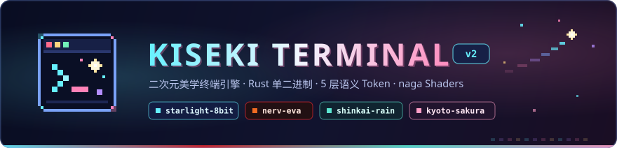

<p align="center">
  
</p>

<p align="center">
  <a href="https://github.com/nerv-base/kiseki-terminal/releases"></a>
  <a href="./LICENSE"></a>
  
  
  
</p>

> 二次元跨平台终端美学合集 — **Windows Terminal** & **macOS (Ghostty / iTerm2 / Kitty / WezTerm)**。  
> 定制左右分区壁纸 · 60fps HLSL/GLSL 动态着色器 · 16 色 ANSI · Oh My Posh · Fastfetch · 方向键交互切主题。

---

## Quick Install / 一键安装

**macOS（Ghostty / iTerm2 / Kitty / WezTerm + zsh / bash）**
```bash
curl -fsSL https://raw.githubusercontent.com/nerv-base/kiseki-terminal/main/install.sh | bash
```

**Windows（Windows Terminal 1.21+ / PowerShell）**
```powershell
irm https://raw.githubusercontent.com/nerv-base/kiseki-terminal/main/install.ps1 | iex
```

> 安装前自动备份原配置至 `~/.config/kiseki-backup-*`，非侵入挂载。macOS 安装完可直接输入 `themes` 使用，无需 `source ~/.zshrc`。

<details>
<summary>本地安装 / 可选参数 / 卸载</summary>

**macOS**
```bash
git clone https://github.com/nerv-base/kiseki-terminal.git && cd kiseki-terminal
./install.sh [--theme nerv-eva] [--static] [--terminal auto|ghostty|iterm2|kitty|wezterm] [--skip-tools] [--skip-fonts]
./install.sh --uninstall   # 干净卸载所有终端与 Shell 挂载
```

**Windows**
```powershell
git clone https://github.com/nerv-base/kiseki-terminal.git; cd kiseki-terminal
powershell -ExecutionPolicy Bypass -File .\install.ps1 [-Theme nerv-eva] [-Static] [-SkipTools] [-SkipFonts]
```

</details>

---

## Gallery / 主题预览

### `starlight-8bit` — 星屑 8-Bit
> 复古像素夜空 · 闪烁星空与流星 Shader · `DepartureMono NF` + `Fusion Pixel 12px`


### `nerv-eva` — NERV UNIT-02
> 特务机关弐号机蓝图 · MAGI 扫描带 + AT-Field 网格 + 故障脉冲 · `JetBrainsMono NF`


### `shinkai-rain` — 言叶之雨
> 东京雨夜厚涂电影感 · 视差雨丝 + 积水涟漪 + 暖金散景 · `Maple Mono NF CN`


### `kyoto-sakura` — 夜樱绘卷
> 和风月夜神社 · 飘落樱瓣 + 萤火虫 + 灯笼摇曳 + 镜池微澜 · `Maple Mono NF CN`


---

## Commands / 常用命令

| 命令 | 说明 |
| :--- | :--- |
| `themes` | 交互式主题选择器（`↑`/`↓` 选择，`Space` 实时预览，`Enter` 切换，`q`/`Esc` 退出） |
| `theme <id>` | 直接切换主题（`starlight-8bit` / `nerv-eva` / `shinkai-rain` / `kyoto-sakura`） |
| `live` / `crt` | 开关 **60fps GPU 动态背景** / 复古 CRT 扫描线着色器 |
| `termfont <style>` | 切换字体栈（`8bit` / `code` / `maple` / `modern`） |
| `termbg <0..1 \| off>` | 调节壁纸透明度或关闭壁纸（Windows 亦支持 `termbg -Off`） |
| `fetch` | 重新展示当前主题 Fastfetch 状态卡 |
| `theme update` | 热更新到最新 Release（`check` / `mute` / `unmute` 管理 24h 静默提醒） |

---

## Terminal Support / 终端支持

| 终端 | 配色 / 字体 / 磨砂 | 壁纸 | 60fps Shader / CRT | 热切换 |
| :--- | :---: | :---: | :---: | :---: |
| **Windows Terminal 1.21+** | ✅ | ✅ | ✅ (`HLSL`) | ✅ 自动 |
| **Ghostty 1.2+ (推荐 1.3+)** | ✅ | ✅ | ✅ (`GLSL`) | ✅ `SIGUSR2` |
| **iTerm2** | ✅ | ✅ | — | ✅ OSC 1337 |
| **Kitty / WezTerm** | ✅ | ✅ | — | ✅ 自动 |
| **Terminal.app / Warp / 其他** | ✅ Shell + OSC | — | — | ✅ |

---

## Credits & License

[Departure Mono](https://github.com/rektdeckard/departure-mono) · [Fusion Pixel](https://github.com/TakWolf/fusion-pixel-font) · [Maple Mono NF CN](https://github.com/subframe7536/maple-font) · [Nerd Fonts](https://github.com/ryanoasis/nerd-fonts) · [Oh My Posh](https://ohmyposh.dev) · [Fastfetch](https://github.com/fastfetch-cli/fastfetch) · [eza](https://github.com/eza-community/eza) · [bat](https://github.com/sharkdp/bat) · [fzf](https://github.com/junegunn/fzf) · [zoxide](https://github.com/ajeetdsouza/zoxide)

MIT © nerv-base
