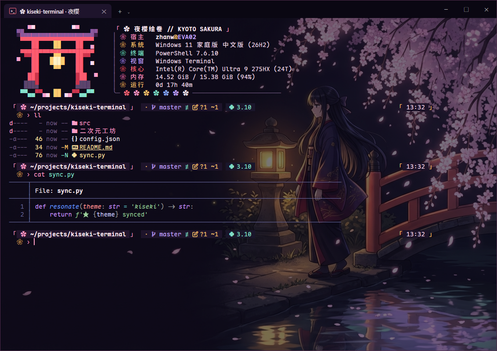

# ★ Kiseki Terminal — Anime Theme Collection for Windows Terminal

> 一套专为 **Windows Terminal + PowerShell + Oh My Posh + Fastfetch** 打造的二次元终端美学合集。  
> 每套主题都包含 **按终端左右阅读区专门构图的二次元壁纸**、**从画面精确取色的 16 色 ANSI 方案**、**专属 Oh My Posh 提示符**、**手绘真彩半块像素 Fastfetch 徽章**、**定制字体栈**，以及 **一键热切换引擎**。

---

## Gallery / 主题预览

### 1. `starlight-8bit` — 星屑 8-Bit（复古像素夜空）
> PC-98 / GBA 像素风 · 深靛夜空 `#0A0F25` + 街机霓虹青 + 樱花粉 · `DepartureMono NF` + `Fusion Pixel 12px` 像素中文 · RPG 抖动渐变 HUD (`░▒▓ ... ▓▒░` / `♥ ▶`)


---

### 2. `nerv-eva` — NERV UNIT-02（特务机关 弐号机战术蓝图）
> 延续 [nerv-base/dsh-theme-eva](https://github.com/nerv-base/dsh-theme-eva) 设计语言 · 曜石暗黑 `#0B090A` + 弐号机装甲绯红 `#D8262E` + 战术橙标 `#F06A22` + 同步率荧光绿 `#3FE08A` · 右侧全高线稿蓝图与切角 `02` 铭牌 · `JetBrainsMono NF` · `▛ 02 ▟` / `┗━[弐号機] ▸`


---

### 3. `shinkai-rain` — 言叶之雨（新海诚东京雨夜）
> 剧场版厚涂雨夜电影感 · 靛青雨幕 `#0C1823` + 霓虹水青 + 便利店暖金散景 · `Maple Mono NF CN` · 极简玻璃雨滴弧线提示符 (`╭─ ☂ ...` / `╰─ ❯`)


---

### 4. `kyoto-sakura` — 夜樱绘卷（和风月夜神社）
> 和风幻想剧场版 · 墨紫夜空 `#0F0B19` + 月下垂枝樱粉 + 石灯笼暖金 + 朱红鸟居 · `Maple Mono NF CN` · 日式直角引号印章提示符 (`「 ✿ ... 」` / `❀ ›`)



---

## Features / 核心特性

- **终端专属壁纸构图**：4 张壁纸均采用「左侧 58% 低干扰深色代码区 + 右下角 42% 视觉焦点」构图，并通过 `bottomRight` 锚定与精准取色背景，彻底告别“背景图挡字发灰”的问题。
- **全链路色彩统一**：一套主题同步控制 Windows Terminal 窗口框架/标签页配色、ANSI 16 色、Oh My Posh 提示符、Fastfetch 卡片、PSReadLine 语法高亮、`eza` 文件树、`bat` 代码高亮、`fzf` 模糊搜索框。
- **开箱即用的实时热切换**：一条命令即可在 4 套风格间秒切，Windows Terminal 即时热重载，无需重启终端。
- **可选轻量级 CRT 着色器**：内置自定义 HLSL 着色器（`shaders/retro-crt-subtle.hlsl`），`crt` 命令随时开关复古荧光辉光与微弱扫描线。

---

## Quick Install / 一键安装

> 环境要求：Windows 10 / 11 + [Windows Terminal](https://aka.ms/terminal) + PowerShell（推荐 PowerShell 7+）

### 方式一：一行命令直接安装（推荐，无需先 clone）

打开 PowerShell，直接粘贴运行：

```powershell
irm https://raw.githubusercontent.com/nerv-base/kiseki-terminal/main/install.ps1 | iex
```

### 方式二：Git Clone 本地安装（支持自定义参数）

```powershell
git clone https://github.com/nerv-base/kiseki-terminal.git
cd kiseki-terminal
powershell -ExecutionPolicy Bypass -File .\install.ps1
```

可选参数：
- `-Theme nerv-eva` — 指定默认启用的主题（`starlight-8bit` / `nerv-eva` / `shinkai-rain` / `kyoto-sakura`）
- `-SkipTools` — 跳过 `winget` 工具安装（已安装 `oh-my-posh` / `eza` / `bat` / `fzf` / `zoxide` / `fastfetch` 时使用）
- `-SkipFonts` — 跳过字体自动下载

安装前会自动备份原有 Windows Terminal `settings.json` 与 PowerShell `$PROFILE` 到 `~/.config/kiseki-backup-*`；安装完成后重开一个 Windows Terminal 窗口即可生效。

---

## Commands / 常用切换命令

| 命令 | 说明 |
| :--- | :--- |
| `themes` | 查看所有已安装的二次元主题与当前激活状态 |
| `theme starlight-8bit` | 实时切换到「星屑 8-Bit」 |
| `theme nerv-eva` | 实时切换到「NERV MAGI 02」 |
| `theme shinkai-rain` | 实时切换到「言叶之雨」 |
| `theme kyoto-sakura` | 实时切换到「夜樱绘卷」 |
| `crt` | 实时开/关复古 CRT 荧光辉光 + 扫描线 Shader |
| `termfont 8bit \| code \| maple \| modern` | 单独切换字体栈（保留像素或圆体中文） |
| `termbg 0.35` / `termbg -Off` | 微调壁纸透明度或暂时关闭壁纸 |
| `fetch` | 重新展示当前主题的定制 Fastfetch 徽章与状态卡 |

---

## Credits & Fonts / 字体与开源组件

- [Departure Mono](https://github.com/rektdeckard/departure-mono) & [Nerd Fonts](https://github.com/ryanoasis/nerd-fonts)
- [Fusion Pixel Font (缝合像素字体)](https://github.com/TakWolf/fusion-pixel-font)
- [Maple Mono NF CN](https://github.com/subframe7536/maple-font)
- [Oh My Posh](https://ohmyposh.dev) · [Fastfetch](https://github.com/fastfetch-cli/fastfetch) · [eza](https://github.com/eza-community/eza) · [bat](https://github.com/sharkdp/bat) · [fzf](https://github.com/junegunn/fzf) · [zoxide](https://github.com/ajeetdsouza/zoxide)

## License

MIT
