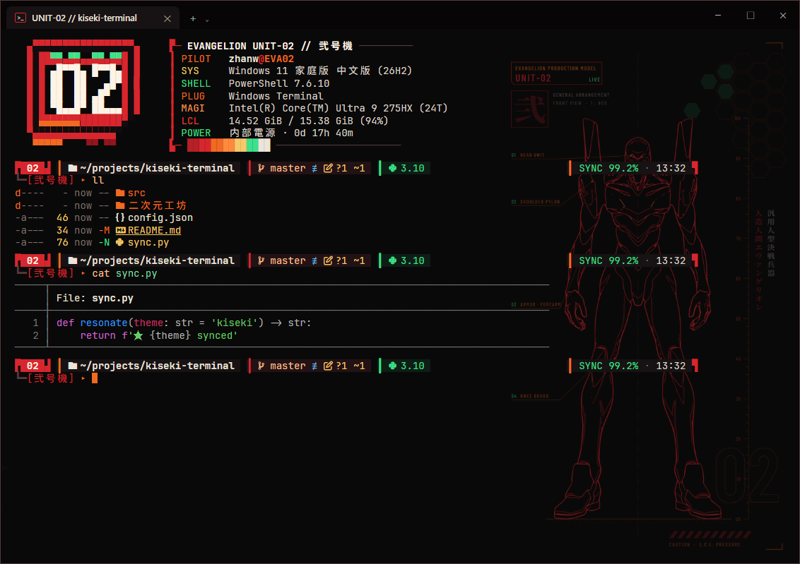

<p align="center">
  
</p>

<p align="center">
  <a href="https://github.com/nerv-base/kiseki-terminal/releases"></a>
  <a href="./LICENSE"></a>
  
  
  
</p>

> 一套专为 **Windows Terminal (PowerShell)** 与 **macOS（Ghostty / iTerm2 / Kitty / WezTerm + zsh / bash）** 打造的二次元终端美学合集。  
> 每套主题都包含 **按终端左右阅读区专门构图的二次元壁纸**、**从画面精确取色的 16 色 ANSI 方案**、**专属 Oh My Posh 提示符**、**手绘真彩半块像素 Fastfetch 徽章**、**定制字体栈**，以及 **一键热切换引擎**。

---

## Gallery / 主题预览

### 1. `starlight-8bit` — 星屑 8-Bit（复古像素夜空）
> PC-98 / GBA 像素风 · 深靛夜空 `#0A0F25` + 街机霓虹青 + 樱花粉 · `DepartureMono NF` + `Fusion Pixel 12px` 像素中文 · RPG 抖动渐变 HUD (`░▒▓ ... ▓▒░` / `♥ ▶`)


---

### 2. `nerv-eva` — NERV UNIT-02（特务机关 弐号机战术蓝图）
> 延续 [nerv-base/dsh-theme-eva](https://github.com/nerv-base/dsh-theme-eva) 设计语言 · 曜石暗黑 `#0B090A` + 弐号机装甲绯红 `#D8262E` + 战术橙标 `#F06A22` + 同步率荧光绿 `#3FE08A` · 右侧全高线稿蓝图与切角 `02` 铭牌 · `JetBrainsMono NF` · `▛ 02 ▟` / `┗━[弐号機] ▸`



---

### 3. `shinkai-rain` — 言叶之雨（新海诚东京雨夜）
> 剧场版厚涂雨夜电影感 · 靛青雨幕 `#0C1823` + 霓虹水青 + 便利店暖金散景 · `Maple Mono NF CN` · 极简玻璃雨滴弧线提示符 (`╭─ ☂ ...` / `╰─ ❯`)


---

### 4. `kyoto-sakura` — 夜樱绘卷（和风月夜神社）
> 和风幻想剧场版 · 墨紫夜空 `#0F0B19` + 月下垂枝樱粉 + 石灯笼暖金 + 朱红鸟居 · `Maple Mono NF CN` · 日式直角引号印章提示符 (`「 ✿ ... 」` / `❀ ›`)


---

## Features / 核心特性

- **60fps GPU 实时动态背景（4 套专属 HLSL + GLSL 着色器）**：Windows Terminal 基于原生 `experimental.pixelShaderPath` + `experimental.pixelShaderImagePath`（`live.hlsl`），macOS Ghostty 基于 `background-image` + Shadertoy `custom-shader`（`live.glsl`），在不牺牲原图真彩画质的前提下实现实时动态效果，且**代码文字层保持锐利清晰**：
  - `starlight-8bit`：3×3 像素网格闪烁星空 + 周期性斜向像素流星 + 海面波光微颤 + CRT 呼吸光
  - `nerv-eva`：MAGI 琥珀扫描光带 + AT-Field 六边形战术网格脉动 + 周期性水平切片 RGB 色差故障脉冲 + 蓝图红线同步心跳
  - `shinkai-rain`：双层视差斜向东京雨丝 + 右下角湿漉积水涟漪折射 + 路灯与便利店散景呼吸光
  - `kyoto-sakura`：双层飘落翻转樱花花瓣 + 游曳暖金萤火虫 + 石灯笼烛火摇曳 + 寺庙镜池水面微澜
- **终端专属壁纸构图**：4 张壁纸均采用「左侧 58% 低干扰深色代码区 + 右下角 42% 视觉焦点」构图，配合 `UniformToFill / Cover + BottomRight` 锚定，任意缩放窗口都不拉伸变形、不挡字。
- **全链路色彩统一**：一套主题同步控制终端配色与窗口/标签页、ANSI 16 色、Oh My Posh 提示符、Fastfetch 卡片、PSReadLine / `zsh-syntax-highlighting` / `zsh-autosuggestions` 语法高亮、`eza` 文件树、`bat` 代码高亮、`fzf` 模糊搜索框。
- **开箱即用的实时热切换 & 动静一键开关**：`theme <id>` 秒切主题，`live` 随时在 **60fps 动态模式** 与 **零功耗静态模式** 间切换，另有 `crt` 可选复古扫描线着色器。

---

## Terminal Support Matrix / 终端支持矩阵

| 终端 | 平台 | 16色 + 字体 + 磨砂 | 二次元壁纸 | 60fps 动态 / CRT Shader | `theme <id>` 热切换 |
| :--- | :--- | :---: | :---: | :---: | :---: |
| **Windows Terminal 1.21+** | Windows | ✅ | ✅ | ✅ (`live.hlsl` / `crt`) | ✅ 自动重载 |
| **Ghostty 1.2+ (推荐 1.3+)** | macOS / Linux | ✅ | ✅ | ✅ (`live.glsl` / `crt`) | ✅ `SIGUSR2` / AppleScript 自动重载 |
| **iTerm2** | macOS | ✅ | ✅ | —（静态壁纸） | ✅ Dynamic Profiles + OSC 1337 秒切 |
| **Kitty** | macOS / Linux | ✅ | ✅ | —（静态壁纸） | ✅ `include` + `SIGUSR1` 热重载 |
| **WezTerm** | macOS / Linux | ✅ | ✅ | —（静态壁纸） | ✅ Lua 模块自动监听重载 |
| **Terminal.app / Warp / 其他** | macOS / Unix | ✅ Shell 全套 + OSC 配色 | — | — | ✅ 提示符 / Fastfetch / CLI 配色 |

---

## Quick Install / 一键安装

### macOS（Ghostty / iTerm2 / Kitty / WezTerm + zsh / bash）

> 环境要求：macOS + `zsh`（或 `bash`）+ `python3`，推荐安装 [Ghostty](https://ghostty.org)（完整支持 60fps GLSL 动态背景与 CRT 着色器）或 [iTerm2](https://iterm2.com)，并安装 [Homebrew](https://brew.sh) 以自动获取 `oh-my-posh` / `fastfetch` / `eza` / `bat` / `fzf` / `zoxide`。

#### 方式一：一行命令直接安装（推荐，无需先 clone）

```bash
curl -fsSL https://raw.githubusercontent.com/nerv-base/kiseki-terminal/main/install.sh | bash
```

#### 方式二：Git Clone 本地安装（支持自定义参数）

```bash
git clone https://github.com/nerv-base/kiseki-terminal.git
cd kiseki-terminal
./install.sh
```

可选参数：
- `--theme nerv-eva` — 指定默认启用的主题（`starlight-8bit` / `nerv-eva` / `shinkai-rain` / `kyoto-sakura`）
- `--static` — 默认使用零 GPU 重绘的静态壁纸模式（随时可用 `live` 开启 Ghostty 60fps 动态效果）
- `--terminal ghostty` — 指定目标终端（`auto` / `ghostty` / `iterm2` / `kitty` / `wezterm` / `all` / `none`，默认自动检测本机已装终端）
- `--skip-tools` — 跳过 Homebrew CLI 工具安装
- `--skip-fonts` — 跳过字体自动下载到 `~/Library/Fonts`
- `--uninstall` — 干净移除 shell 与各终端里的 Kiseki 配置挂钩

安装前会自动备份原有 `~/.zshrc`、Ghostty / iTerm2 / Kitty / WezTerm 配置到 `~/.config/kiseki-backup-*`；所有终端配置均通过单行 `config-file` / Dynamic Profile / `include` 非侵入式挂载，不会覆盖你原有的个人配置。同时会自动在现有 `PATH`（如 `~/.local/bin` 或 `/opt/homebrew/bin`）写入独立命令入口，**安装完成即可直接输入 `themes` / `theme` / `live` / `crt` 使用，无需手动 `source ~/.zshrc`**（新开标签页自动加载完整 Oh My Posh 提示符与 shell 配色）。
- **Ghostty**：写入一行 `config-file = ?~/.config/kiseki-terminal/generated/ghostty.conf`，切换主题自动热重载（旧版 Ghostty `< 1.3` 按 `Cmd+Shift+,` 重载）。
- **iTerm2**：生成 `DynamicProfiles/kiseki-terminal.json`（含 `Kiseki Active` 与 4 套独立主题 Profile），在 iTerm2 内运行 `theme <id>` 会通过 `OSC 1337` 立即切换当前标签页。

---

### Windows（Windows Terminal + PowerShell）

> 环境要求：Windows 10 / 11 + [Windows Terminal](https://aka.ms/terminal) + PowerShell（推荐 PowerShell 7+）

#### 方式一：一行命令直接安装（推荐，无需先 clone）

打开 PowerShell，直接粘贴运行：

```powershell
irm https://raw.githubusercontent.com/nerv-base/kiseki-terminal/main/install.ps1 | iex
```

#### 方式二：Git Clone 本地安装（支持自定义参数）

```powershell
git clone https://github.com/nerv-base/kiseki-terminal.git
cd kiseki-terminal
powershell -ExecutionPolicy Bypass -File .\install.ps1
```

可选参数：
- `-Theme nerv-eva` — 指定默认启用的主题（`starlight-8bit` / `nerv-eva` / `shinkai-rain` / `kyoto-sakura`）
- `-Static` — 默认使用零 GPU 重绘的静态背景模式（随时可用 `live` 开启 60fps 动态效果）
- `-SkipTools` — 跳过 `winget` 工具安装（已安装 `oh-my-posh` / `eza` / `bat` / `fzf` / `zoxide` / `fastfetch` 时使用）
- `-SkipFonts` — 跳过字体自动下载

安装前会自动备份原有 Windows Terminal `settings.json` 与 PowerShell `$PROFILE` 到 `~/.config/kiseki-backup-*`；安装完成后重开一个 Windows Terminal 窗口即可生效。

---

## Commands / 常用切换命令

| 命令 | 说明 |
| :--- | :--- |
| `themes` | 打开交互式主题选择器（`↑`/`↓` 或 `j`/`k` 选择，`Space` 实时预览，`Enter` 切换，`q`/`Esc` 退出；加 `--list` / `-List` 仅打印列表） |
| `theme starlight-8bit` | 实时切换到「星屑 8-Bit」 |
| `theme nerv-eva` | 实时切换到「NERV MAGI 02」 |
| `theme shinkai-rain` | 实时切换到「言叶之雨」 |
| `theme kyoto-sakura` | 实时切换到「夜樱绘卷」 |
| `live` / `motion` | 实时开/关 **60fps GPU 动态背景**（离电省电时可随时一键切静态） |
| `crt` | 实时开/关复古 CRT 荧光辉光 + 扫描线 Shader |
| `termfont 8bit \| code \| maple \| modern` | 单独切换字体栈（保留像素或圆体中文） |
| `termbg 0.35` / `termbg -Off` | 微调壁纸透明度或暂时关闭壁纸 |
| `fetch` | 重新展示当前主题的定制 Fastfetch 徽章与状态卡 |
| `theme update` | 一键热更新到最新 GitHub Release（保留当前主题和动静开关，无需重装字体与工具） |
| `theme update check` | 手动立即检查是否有新版本或新主题 |
| `theme update mute` / `unmute` | 关闭 / 开启启动时的自动更新提醒 |

---

## Updating / 自动更新提醒与热升级

- 每 **24 小时**在后台静默检查一次新版本（不阻塞终端启动、不消耗 GitHub API 配额）；
- 当仓库发布新 Release 或新增主题时，打开终端会在 Fastfetch 下方温和提示一行，输入 `theme update` 即可在几秒内完成热升级，自动保留你的当前主题和 `live` 开关；
- 如需关闭自动提醒，执行 `theme update mute`（或设置环境变量 `KISEKI_NO_UPDATE_CHECK=1`）。

---

## Credits & Fonts / 字体与开源组件

- [Departure Mono](https://github.com/rektdeckard/departure-mono) & [Nerd Fonts](https://github.com/ryanoasis/nerd-fonts)
- [Fusion Pixel Font (缝合像素字体)](https://github.com/TakWolf/fusion-pixel-font)
- [Maple Mono NF CN](https://github.com/subframe7536/maple-font)
- [Oh My Posh](https://ohmyposh.dev) · [Fastfetch](https://github.com/fastfetch-cli/fastfetch) · [eza](https://github.com/eza-community/eza) · [bat](https://github.com/sharkdp/bat) · [fzf](https://github.com/junegunn/fzf) · [zoxide](https://github.com/ajeetdsouza/zoxide)

## License

MIT
