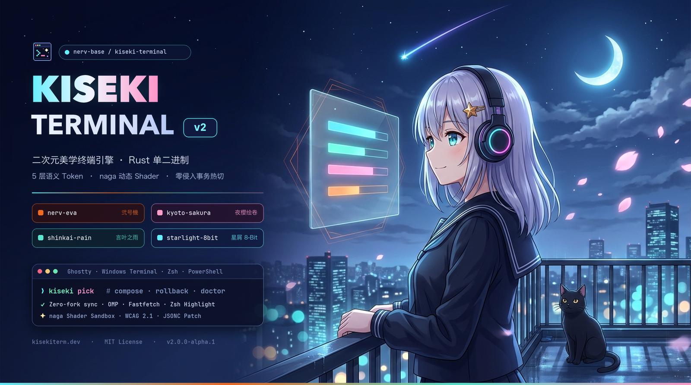
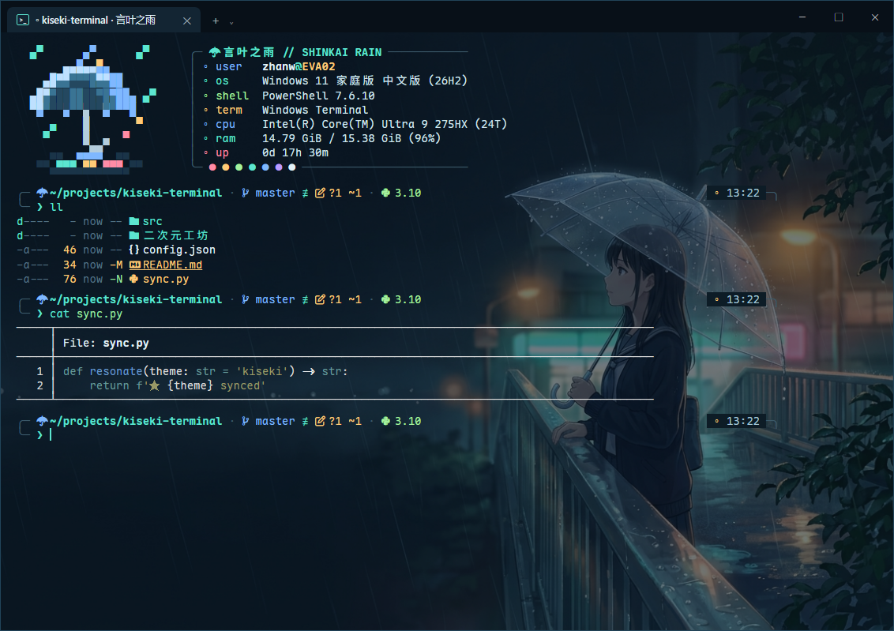
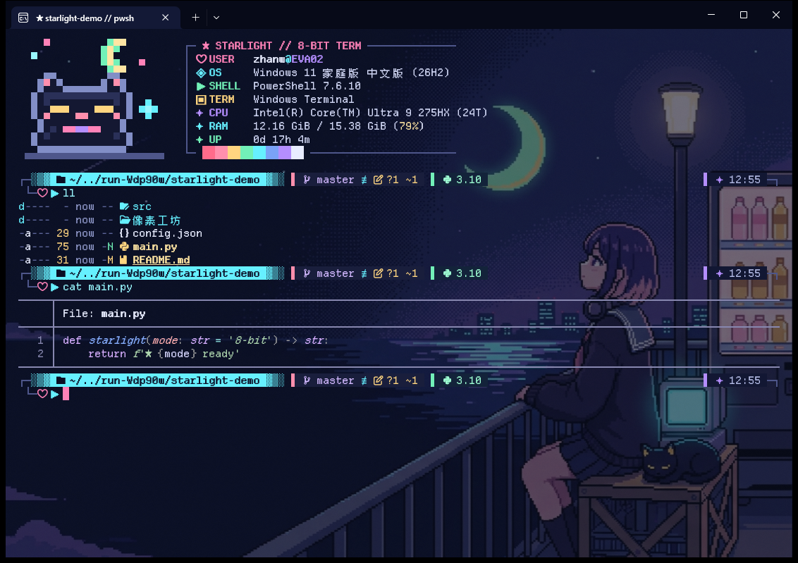

<p align="center">
  
</p>

<p align="center">
  <a href="https://kisekiterm.dev"></a>
  <a href="./LICENSE"></a>
  
  
  
</p>

> **Kiseki Terminal v2** — 面向终端生态的统一视觉与沉浸式主题引擎（Rust 单二进制，零运行时脚本依赖）。  
> 5 层语义设计 Token · 按层混搭（`compose`）· 参数化 GLSL/HLSL 动态 Shader（内置 `naga` 校验）· 非侵入式事务挂载与一键回滚 · 社区主题包安全沙箱校验。

---

## 核心特性（v2 架构）

- **单二进制离线开箱即用**：内置全部 4 套官方主题包（壁纸 / TrueColor Logo / GLSL+HLSL Shader / 5 层 Token），无需 Python 或外部运行时。
- **零侵入挂载 & 事务可回滚**：宿主配置仅通过外部 `include` / 标记块 / 无损 JSONC 叶子补丁挂载，每次变更写入事务日志，支持 `kiseki rollback` 一键还原与 `kiseki recover --safe` 紧急逃生。
- **绝不劫持终端行为**：只接管视觉层（配色 / 字体 / 壁纸 / Shader / Prompt / Fastfetch / 命令行语法高亮色板），绝不篡改 `ls`/`cat`/`cd` 别名、键位绑定或用户 Shell 行为；提供 `--render-only` 纯产物模式适配 Nix / Home Manager / Dotfiles。
- **零 fork 热同步**：Zsh / PowerShell 钩子在无变更热路径仅读取 `state.gen` 整数比较，零子进程开销；切换主题后 Ghostty（`SIGUSR2`）、Oh My Posh Prompt、标签页标题、Fastfetch 与 `zsh-syntax-highlighting` 即时联动。
- **强安全社区主题包**：纯声明式 JSON + `naga` Shader 静态编译与 TDR 复杂度预算 + WCAG 2.1 对比度门禁 + 白名单扩展名 / 拒绝符号链接与任何可执行脚本。

---

## 官方主题一览

| 主题 ID | 名称 | 风格 | Prompt 预设 |
| :--- | :--- | :--- | :--- |
| `nerv-eva` | **NERV UNIT-02** | 特務機関 NERV 弐号機 · 战术蓝图暗红橙 · MAGI 扫描线 + AT-Field 六边形 | `tactical-bar` |
| `kyoto-sakura` | **Kyoto Sakura** | 夜樱绘卷 · 和风月夜神社 · 垂枝樱瓣 + 萤火虫 + 灯笼摇曳 + 镜池微澜 | `shrine-ribbon` |
| `shinkai-rain` | **Shinkai Rain** | 言叶之雨 · 新海诚东京雨夜 · 视差雨丝 + 积水涟漪 + 暖金散景 | `cinematic-line` |
| `starlight-8bit` | **Starlight 8-Bit** | 星屑 8-Bit · 复古像素夜空 · 像素星海闪烁 + 定时流星 | `pixel-frame` |





---

## 构建与快速开始

需要 Rust 1.85+：

```bash
git clone -b v2 https://github.com/nerv-base/kiseki-terminal.git
cd kiseki-terminal
cargo build --release -p kiseki-cli

# 软链到 PATH（例如 ~/.local/bin）
mkdir -p ~/.local/bin
ln -sf "$PWD/target/release/kiseki" ~/.local/bin/kiseki

# 一键初始化向导（自动探测环境、兼容 v1 迁移并安全挂载）
kiseki init
```

> 可选推荐：macOS 安装 `brew install oh-my-posh fastfetch zsh-syntax-highlighting` 以解锁完整主题 Prompt、置顶系统信息卡与 24 项命令实时语法高亮。

---

## 常用命令

| 命令 | 说明 |
| :--- | :--- |
| `kiseki init` | 交互式初始化向导（支持 `--non-interactive` / `--render-only`） |
| `kiseki pick` | 方向键交互式主题选择器（清屏置顶 Fastfetch + 实时热切） |
| `kiseki use <id>` | 直接切换指定主题（`nerv-eva` / `kyoto-sakura` / `shinkai-rain` / `starlight-8bit` 或社区主题） |
| `kiseki compose` | 按层混搭多个主题（如 `--palette kyoto-sakura --atmosphere starlight-8bit`，`--reset` 重置） |
| `kiseki profile <tier>` | 切换渲染档位：`static` / `eco` / `balanced` / `ultra` / `accessibility` |
| `kiseki live [on\|off]` | 快速开关动态 Shader（`balanced` ↔ `static`） |
| `kiseki bg <0..1\|off\|reset>` | 调整壁纸透明度、关闭或恢复主题默认 |
| `kiseki font` | 覆盖终端字体栈、字号或锁定字体不被主题覆盖（`--lock` / `--unlock`） |
| `kiseki status` | 查看当前主题、环境、适配器与产物状态（支持 `--json`） |
| `kiseki doctor` | 全链路诊断（路径权限、字体、Shader 校验、Ghostty 配置验证等） |
| `kiseki rollback [tx-id]` | 回滚到上一次或指定历史事务快照 |
| `kiseki recover --safe` | 安全逃生：强制静态模式、关闭 Shader、损坏自动修复 |
| `kiseki theme list\|info\|validate\|install\|remove` | 管理与安全校验本地/社区主题包 |
| `kiseki migrate [--apply]` | 探测并可逆迁移 Kiseki v1 旧版安装 |
| `kiseki uninstall [--purge]` | 干净撤销所有宿主挂载（加 `--purge` 清除本地数据） |

---

## 架构文档与 Schema

- 架构 RFC：[docs/rfc/README.md](./docs/rfc/README.md) · [0001-architecture-and-workspace.md](./docs/rfc/0001-architecture-and-workspace.md) · [0002-theme-schema-and-tokens.md](./docs/rfc/0002-theme-schema-and-tokens.md) · [0003-adapter-contract-and-capabilities.md](./docs/rfc/0003-adapter-contract-and-capabilities.md) · [0004-shader-pipeline-and-security.md](./docs/rfc/0004-shader-pipeline-and-security.md)
- JSON Schemas：[schemas/manifest.v1.schema.json](./schemas/manifest.v1.schema.json) · [schemas/tokens.v1.schema.json](./schemas/tokens.v1.schema.json)

---

## License

MIT © Kiseki Terminal Contributors · [https://kisekiterm.dev](https://kisekiterm.dev)
