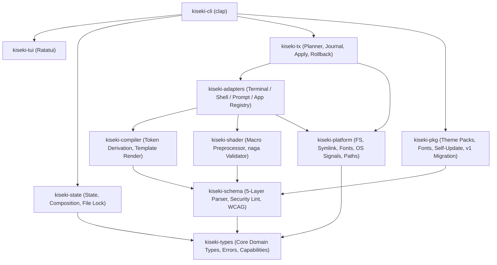

# RFC-0001: Core Architecture, Workspace Layout, CLI, State & Distribution

- **Status**: Draft
- **Applies To**: Kiseki Terminal `v2` (Rust Core)
- **Related**: [RFC-0002](./0002-theme-schema-and-tokens.md), [RFC-0003](./0003-adapter-contract-and-capabilities.md), [RFC-0004](./0004-shader-pipeline-and-security.md)

---

## 1. 设计目标与非目标

### 目标
1. **Local-first & Zero Daemon**：所有核心操作（切主题、渲染配置、Shader 校验、多窗口同步、回滚）完全离线可用，默认零常驻后台进程。
2. **Appearance First, Behavior Unchanged**：只改变视觉呈现，不篡改 Shell 命令语义（`cat`/`ls`/`grep`）、不劫持键位绑定、不破坏用户已有 Prompt 布局或 dotfiles 软链接结构。
3. **双核并重**：同时支撑高表现力沉浸式渲染（分区壁纸、60fps 参数化 HLSL/GLSL Shader、精选字体栈）与 20+ 终端生态应用的统一 Semantic Tokens 编译。
4. **单二进制 Rust 单栈**：消除 v1 的 Python + PowerShell 双套实现漂移，消除外部校验工具依赖（内嵌 `naga`），单文件跨平台分发。

### 明确非目标（v2.0 阶段）
- 不自行编写终端模拟器或替代 GPU 终端渲染器（复用宿主渲染管线）。
- 不支持可执行第三方插件运行时（Adapter 均在编译期静态注册）。
- 不修改 SSH 远端主机环境（默认只处理本地兼容与降级）。
- Native GUI 与带账号后端的 Gallery 不纳入 v2.0 主线。

---

## 2. 总体架构与模块依赖（Modular Monolith）



### Cargo Workspace 目录规划

```text
kiseki-terminal/                 # v2 分支根目录（单仓）
├── Cargo.toml                   # Workspace 定义 + 统一依赖版本
├── dist-workspace.toml          # cargo-dist 跨平台发布配置
├── crates/
│   ├── kiseki-types/            # 纯领域类型：Color(sRGB/OKLCH)、ThemeId、RenderingProfile、CapabilityFlags、Diagnostic
│   ├── kiseki-schema/           # manifest.json / tokens.json 反序列化、安全白名单校验、L1->L2 推导、WCAG/APCA 对比度检查
│   ├── kiseki-shader/           # GLSL/HLSL 参数化宏预处理、内嵌 naga 静态解析/校验/复杂度预算检查
│   ├── kiseki-compiler/         # 统一编译管线：将 ResolvedTheme 编译为各目标应用的纯内存产物（ArtifactMap）
│   ├── kiseki-platform/         # 跨平台服务：XDG/Windows 路径、Symlink 安全读写、文件锁、字体探测(CoreText/DirectWrite/Fontconfig)、进程信号与电源状态
│   ├── kiseki-adapters/         # Adapter Trait + Registry + 分层实现（terminals/, shells/, prompts/, apps/）
│   ├── kiseki-tx/               # 变更规划（Plan）、快照（Snapshot）、分目标事务提交（Apply）、Journal 回滚（Rollback）、Doctor 诊断
│   ├── kiseki-state/            # state.json 管理、层混搭组合解析、state.gen 生成、临时预览会话管理
│   ├── kiseki-pkg/              # 官方内置主题解包、外部主题安装/校验/卸载、字体清单下载、SHA256 自更新、v1->v2 自动迁移
│   ├── kiseki-tui/              # Ratatui 交互式主题选择器（实时无副作用预览、搜索、按层混搭切换、渲染档位切换）
│   └── kiseki-cli/              # 主二进制入口 `kiseki`（clap 命令路由、结构化输出、JSON 模式、补全脚本生成）
├── themes/                      # 4 个官方旗舰主题源码（构建时压缩/嵌入二进制，离线可用）
│   ├── starlight-8bit/
│   ├── nerv-eva/
│   ├── shinkai-rain/
│   └── kyoto-sakura/
├── shaders/                     # 公共可复用后处理模板（如 retro-crt-subtle.{glsl,hlsl}）
├── schemas/                     # 对外发布的 JSON Schema（manifest.v1 / tokens.v1）
└── docs/rfc/                    # 架构规范文档
```

**关键依赖铁律**：
- `kiseki-types`、`kiseki-schema`、`kiseki-shader`、`kiseki-compiler` **严禁做任何宿主文件系统写入或进程执行（纯函数/确定性编译）**，确保 100% 可用单元测试和 `insta` 快照测试覆盖。
- 所有副作用（读/写配置、发信号、查系统字体、网络下载）被严格隔离在 `kiseki-platform`、`kiseki-tx` 和 `kiseki-pkg` 内，并通过 Trait 注入支持 Mock 测试。

---

## 3. CLI 命令设计（单一命名空间 `kiseki`）

依据 ADR-005，v2 不再向 `$PATH` 写入 `theme`、`live`、`motion`、`crt`、`fetch` 等 8 个无前缀脚本，全部收口到 **`kiseki`** 主命令下：

### 核心日常命令

```text
kiseki                          # 等价于 `kiseki pick`（交互终端）或 `kiseki status`（非 TTY）
kiseki pick                     # Ratatui 交互选择器（实时无副作用预览，支持方向键/搜索/渲染档位切换）
kiseki use <theme-id>           # 切换全局激活主题
  --profile <static|eco|balanced|ultra|accessibility>
  --appearance <auto|dark|light>
  --session                     # 仅对支持单会话切换的终端（iTerm2/Kitty/OSC）临时生效
  --render-only                 # 只编译产物到 generated/，不修改任何宿主配置
  --dry-run                     # 展示变更计划（Plan Diff），不落盘
  --only <adapter,...>          # 仅应用到指定 Adapter
  --quiet / --json              # 静默或机器可读 JSON 输出

kiseki compose                  # 按层混搭（L1–L5 独立覆盖）
  --palette <theme-id>
  --atmosphere <theme-id|none>
  --typography <theme-id|system>
  --prompt <theme-id|palette-only|none>
  --reset                       # 清除混搭覆盖，恢复纯主题

kiseki profile [static|eco|balanced|ultra|accessibility]  # 切换 Rendering Profile
kiseki live [toggle|on|off]     # 快捷切换动态 Shader（balanced <-> static）
kiseki crt [toggle|on|off]      # 开关复古 CRT 后处理叠加
kiseki bg <0.0..1.0|off|reset>  # 覆盖壁纸透明度（直接参数化注入 Live Shader 与静态壁纸）
kiseki font <style|reset> [size] # 覆盖字体栈或字号，支持 `--lock` / `--unlock`
kiseki status [--json]          # 查看当前主题、混搭层、渲染档位、已托管 Adapter 状态
```

### 初始化、维护、恢复与生态命令

```text
kiseki init                     # 交互式初始化向导：
                                #   1) 检测旧版 v1 并引导自动备份迁移
                                #   2) 扫描终端/Shell/Prompt/App 与 Dotfiles(Symlink/只读)
                                #   3) 若检测到自建 OMP/Starship 配置，显式询问覆盖/仅配色/跳过
                                #   4) 提示下载缺失的官方推荐字体
  --aliases                     # 可选：在 Shell 集成中启用 `theme` / `themes` 短别名
  --render-only                 # 仅生成产物，适合 Nix / Home Manager / chezmoi 用户
  --non-interactive             # CI/脚本模式（安全默认：不覆盖已有 Prompt，不破坏只读链接）

kiseki doctor [--fix] [--json]  # 全面诊断：版本、能力矩阵、配置冲突（如 WT 子 Profile 覆盖 defaults）、
                                # 字体缺失、Shader naga 校验、WCAG 对比度、Shell/SSH/WSL/tmux 环境

kiseki rollback [tx-id|--list]  # 按事务日志回滚到指定历史快照（支持单 Adapter 回滚 `--only`）
kiseki recover --safe           # 紧急逃生：强制切为 Static 无 Shader 模式、移除异常自定义配置、救回卡死终端

kiseki theme list               # 列出内置与已安装主题
kiseki theme info <id>          # 查看主题元数据、层级、授权、对比度报告
kiseki theme install <src>      # 安装主题包（本地目录 / `.kiseki.tar.zst` / Registry ID）
kiseki theme remove <id>        # 卸载外部主题包
kiseki theme validate <path>    # Theme SDK：校验 Schema + 安全白名单 + naga Shader + WCAG 对比度
kiseki theme init <id>          # Theme SDK：生成合规的 5 层主题脚手架
kiseki theme pack <path>        # Theme SDK：打包并生成 SHA256 清单

kiseki fonts status             # 检查官方/当前主题字体安装情况与平台名称解析结果
kiseki fonts install [theme|all]# 按内置校验清单下载安装推荐字体（支持离线缓存/镜像）

kiseki update [check|apply|mute|unmute]  # 自更新（检测包管理器归属；独立安装走 SHA256 原子替换）
kiseki migrate                  # 独立执行 v1 -> v2 迁移检查与导入
kiseki uninstall [--purge]      # 全平台干净卸载（含 Windows Terminal JSONC 精准撤销与 PS Profile 清理）
kiseki shell-init <zsh|bash|fish|pwsh>   # 输出轻量 Shell 引导脚本
kiseki completions <shell>      # 输出 clap 原生补全脚本
```

---

## 4. 本地目录结构、状态模型与并发安全

### 目录布局（遵循各平台规范，支持 `KISEKI_HOME` 覆盖）

- **macOS / Linux**：
  - 配置与状态：`${XDG_CONFIG_HOME:-$HOME/.config}/kiseki/`
  - 缓存与下载：`${XDG_CACHE_HOME:-$HOME/.cache}/kiseki/`
  - 主题包与事务快照：`${XDG_DATA_HOME:-$HOME/.local/share}/kiseki/`
- **Windows**：
  - 统一默认根（保持跨平台直观性，同时兼容 `%LOCALAPPDATA%` 缓存）：`%USERPROFILE%\.config\kiseki\`（配置/状态/generated）与 `%LOCALAPPDATA%\kiseki\`（cache/snapshots/downloads）。

内部子目录结构：

```text
<kiseki_config>/
├── config.toml                 # 用户持久偏好（启用哪些 Adapter、Prompt 策略、字体锁、render-only、别名开关）
├── state.json                  # 当前激活状态（Active Theme、混搭层、Rendering Profile、generation 编号）
├── state.gen                   # 纯文本单行版本号（如 `42`），专供 Shell precmd 零 fork 读取
├── .lock                       # 跨进程互斥文件锁（防止多窗口并发切主题写花状态）
├── generated/                  # Kiseki 完全拥有的编译产物目录（所有支持 include 的宿主只引用此目录）
│   ├── env.zsh                 # 预编译 Zsh 环境变量、syntax-highlighting、Prompt 配色/路径
│   ├── env.bash
│   ├── env.fish
│   ├── env.ps1
│   ├── ghostty.conf
│   ├── kitty.conf
│   ├── wezterm.lua
│   ├── alacritty.toml
│   ├── starship-palette.toml
│   ├── prompt.omp.json
│   ├── fastfetch.jsonc
│   ├── tmux.conf
│   ├── zellij.kdl
│   ├── opencode.json
│   ├── lazygit.yml
│   ├── delta.gitconfig
│   ├── bat/Kiseki.tmTheme
│   ├── nvim/kiseki.lua
│   ├── helix/kiseki.toml
│   └── shaders/                # 编译期注入宏后的最终 GLSL / HLSL 文件
│       ├── active.glsl
│       └── active.hlsl
└── preview/                    # 临时预览隔离目录（不触碰 state.json / generated/ 主路径）

<kiseki_data>/
├── themes/
│   ├── official/               # 从二进制内置解包的 4 个官方主题（带 version tag 标记）
│   └── community/              # 用户通过 `kiseki theme install` 安装的第三方主题
└── journal/                    # 事务日志与回滚快照（默认保留最近 20 次操作，含每个修改前文件副本与 SHA256）
    └── 20261126-091500-tx0042/
        ├── manifest.json       # 操作元数据、每个 Adapter 的结果状态与原始值 diff
        └── backups/            # 修改前的宿主文件快照
```

### `state.json` 核心结构

```json
{
  "schemaVersion": 1,
  "generation": 42,
  "activeTheme": "nerv-eva",
  "appearanceMode": "manual",
  "pairing": {
    "dark": "nerv-eva",
    "light": null
  },
  "composition": {
    "palette": null,
    "syntax": null,
    "atmosphere": null,
    "typography": null,
    "overrides": null
  },
  "rendering": {
    "profile": "balanced",
    "crt": false,
    "bgOpacityOverride": null
  },
  "typography": {
    "locked": false,
    "styleOverride": null,
    "sizeOverridePt": null
  },
  "updatedAt": "2026-11-26T09:15:00Z"
}
```

### 并发锁与无副作用临时预览（`kiseki pick`）
1. **文件锁**：任何修改 `state.json`、`generated/` 或宿主配置的操作必须先获取 `<kiseki_config>/.lock` 排他锁（超时 3s 报错提示，绝不静默损坏配置）。
2. **零副作用预览**：
   - `kiseki pick` 启动时，先记录当前的 `active_snapshot`（内存 + `preview/active-preview.lock` 标记，含进程 PID），**绝不修改 `state.json` 或 `state.gen`**。
   - 按 `Space` / 移动光标实时预览时：
     - 对支持会话内切色的终端（iTerm2 OSC 1337 `SetProfile`、Kitty `kitty @ set-colors`、纯 OSC 4/10/11/12）优先走无磁盘写入的会话内预览；
     - 对需配置文件热重载的终端（Ghostty / Windows Terminal），把预览态写入专用临时路径或记录于 `preview/recovery.json`；
     - 退出（`Esc`/`q`/`Ctrl+C`）或异常崩溃（下次任意 `kiseki` 命令启动发现残留的死 PID `preview/recovery.json`）时，自动按 `recovery.json` 瞬间恢复到原 `state.json` 状态。

---

## 5. `< 1ms` 零 Fork 多窗口同步协议

为彻底解决 v1 “窗口 A 切主题，窗口 B 的 Prompt/FZF/EZA/高亮仍停留在旧主题”的问题，同时严格满足 **Zero Daemon** 和 **Shell Hook 无变化检查 ≤ 1ms**，采用 **编译期静态生成 + Shell 内置读取比对 Generation** 机制：

1. 每次 `kiseki use / compose / profile / bg` 成功提交后，Core 同步生成各 Shell 的静态文件 `generated/env.{zsh,bash,fish,ps1}`，并原子递增 `state.gen`（例如内容为 `42\n`）。
2. Shell 侧 `precmd` / `PROMPT_COMMAND` / PowerShell `prompt` wrapper **禁止 fork/exec 任何外部进程（包括 `kiseki` 二进制本身）**，仅使用 Shell 内置读操作比对单行整数：

```zsh
# Zsh (precmd hook — 无变化路径 0 fork，实测 < 0.05ms)
_kiseki_sync_hook() {
  local gen
  if [[ -r "$KISEKI_CONFIG_DIR/state.gen" ]]; then
    read -r gen < "$KISEKI_CONFIG_DIR/state.gen" || return 0
    if [[ "$gen" != "$_KISEKI_LOADED_GEN" ]]; then
      source "$KISEKI_CONFIG_DIR/generated/env.zsh"
      _KISEKI_LOADED_GEN="$gen"
    fi
  fi
}
autoload -Uz add-zsh-hook
add-zsh-hook precmd _kiseki_sync_hook
```

```powershell
# PowerShell (仅在 state.gen 内容变化时点源 env.ps1 — 使用 .NET File.ReadAllText，无子进程)
if (Test-Path $script:KisekiGenFile) {
    $g = [System.IO.File]::ReadAllText($script:KisekiGenFile).Trim()
    if ($g -ne $script:KisekiLoadedGen) {
        . "$script:KisekiConfigDir\generated\env.ps1"
        $script:KisekiLoadedGen = $g
    }
}
```

- **Prompt 热更新**：仅在 `gen` 变化的那一次回车里，`env.{zsh,bash,fish,ps1}` 才会刷新 `FZF_DEFAULT_OPTS`、`EZA_COLORS`、`BAT_THEME`、`ZSH_HIGHLIGHT_STYLES`、`PSReadLine` 颜色、以及更新 `STARSHIP_CONFIG` / `POSH_SESSION_ID` + Oh My Posh 配置引用。
- **行为保护**：生成的 `env.*` 绝不包含任何 `alias cat=...`、`alias ls=...`、`zoxide init` 或键位绑定语句。

---

## 6. 字体管理与安装边界（ADR-007）

1. **完整美学体验默认**：
   - `kiseki init` 引导流程与首次切换到某主题时，检测该主题 `L4 Typography` 声明的字体栈是否已在系统安装。
   - 若缺失官方推荐字体（如 `DepartureMono Nerd Font`、`Fusion Pixel 12px`、`Maple Mono NF CN`、`JetBrainsMono Nerd Font`），**在交互式终端中主动询问是否立即下载安装**（非交互式模式输出明确提示并自动回退至本机可用等宽/CJK 字体）。
2. **不触发 GitHub API 限流 & 可验证下载**：
   - 废弃 v1 运行时请求 `api.github.com/repos/.../releases/latest` 的脆弱做法（未认证 60 次/小时极易撞限流）。
   - Core 内置一份随版本更新的 `font-catalog.json`（含固定上游版本、直链 URL、每个字体文件的 **SHA256 校验和**、协议类型如 OFL-1.1、跨平台 PostScript/DirectWrite/Fontconfig 族名映射）。
3. **跨平台系统探测（零 `osascript`）**：
   - macOS：原生扫描 `/System/Library/Fonts`、`/Library/Fonts`、`~/Library/Fonts` 结合 `ttf-parser`（纯 Rust 读取 OpenType `name` 表，拿到精确 Family Name 与 PostScript Name，**完全告别缓慢的 JXA/osascript**，缓存按目录 mtime 失效）。
   - Windows：通过 `windows-rs` 查询 DirectWrite / 注册表字体表并调用 `AddFontResourceW` + `WM_FONTCHANGE`。
   - Linux：优先扫描 XDG font dirs + `ttf-parser`（可选 `fc-cache` 刷新）。

---

## 7. 打包分发、自更新与 `v1 -> v2` 自动迁移

### 7.1 跨平台构建与双通道分发（`cargo-dist`）
- 目标平台：`aarch64-apple-darwin`、`x86_64-apple-darwin`、`x86_64-pc-windows-msvc`、`aarch64-pc-windows-msvc`、`x86_64-unknown-linux-gnu`、`aarch64-unknown-linux-gnu`（及 `musl` 备选）。
- **内置官方主题**：构建期将 4 个官方主题打包嵌入二进制（当前原始体积 3.6MB，经无损压缩或按需解包至 `<kiseki_data>/themes/official/`），首次运行 0 网络依赖即可离线体验完整旗舰主题。
- **分发渠道**：
  - 包管理器：Homebrew Tap（macOS/Linux）、Scoop & Winget（Windows）、`cargo binstall`。
  - 独立脚本：`cargo-dist` 生成的官方 `install.sh` / `install.ps1`（默认拉取最新 **Tagged Release** + 校验 `checksums.txt`，绝不拉取 `main.zip`）。

### 7.2 事务性自更新（`kiseki update`）
- **安装来源识别**：通过安装元数据（receipt）和二进制路径识别是否由 Homebrew / Scoop / Winget 管理。若是，执行 `kiseki update` 时提示对应的包管理器升级命令（避免绕过包管理器导致校验冲突）。
- **独立安装升级流程**：
  1. 拉取 GitHub Release 固定资产 `manifest.json` + `SHA256SUMS`（可附 Cosign/minisign 签名校验）。
  2. 下载对应平台二进制压缩包至临时目录，**严格校验 SHA256**（校验失败立刻中止，**严禁 fallback 到 `main` 分支**）。
  3. 解压检查可执行文件 `kiseki --version` 健康自检通过后，原子替换（Windows 采用 `kiseki.exe` -> `kiseki.exe.old` 重命名再落盘策略）。
  4. 保留旧版本备份直至新二进制首次运行健康退出，失败自动回滚。

### 7.3 `v1 -> v2` 一键自动迁移（`kiseki init` / `kiseki migrate`）
检测到旧目录 `~/.config/kiseki-terminal/` 或旧钩子标记 `# >>> kiseki-terminal >>>` / `-- >>> kiseki-terminal >>>` 时自动触发：
1. **全量只读备份**：备份旧目录及所有受影响的宿主配置（`.zshrc`、`.bashrc`、PowerShell 5.1/7 Profiles、Ghostty/Kitty/WezTerm/WT/iTerm2/Terminal.app）到 `<kiseki_data>/journal/v1-migration-<ts>/`。
2. **提取用户偏好**：读取 `current-theme.txt`、`live-mode.txt`、`crt-mode.txt`、`bg-opacity.txt`、`font-override.json`、`update-check.txt`、`iterm2-prev-default-guid.txt`、`terminal-app-prev-defaults.json`，映射为 v2 `state.json`。
3. **彻底清理 v1 遗留**：
   - 移除所有 Shell / 终端配置中的 `# >>> kiseki-terminal >>>` 块与 `profile-loader.ps1` 挂载；
   - 依据 `installed-shims.txt` 与 `# kiseki-terminal-shim` 标记，精准删除旧版写入 `$PATH` 的 8 个无前缀 shim；
   - 恢复旧版 iTerm2 / Terminal.app 的原默认 Profile 备份引用；
   - 在 Windows Terminal `settings.json` 中精准清理旧版注册的冗余 `Kiseki` scheme/theme 和强制写入的非视觉键（如 `scrollbarState: hidden`、`bellStyle: none`，提示用户确认是否保留）。
4. **重新挂载 v2**：以非侵入方式完成 v2 初始化并保留 v1 备份目录供随时回退。

---

## 8. 端到端性能预算

| 指标 | 目标值 | 保障机制 |
| :--- | :--- | :--- |
| CLI 冷启动（`kiseki --version` / `status`） | **≤ 10ms**（红线 ≤ 30ms） | Rust 静态二进制 + 懒加载非必要模块 |
| Shell Hook 无变化检查（`precmd`） | **≤ 0.2ms**（红线 ≤ 1ms） | 纯 Shell 内置读 `state.gen`，**零子进程 fork** |
| Shell 启动增量延迟 | **≤ 5ms** | 预编译静态 `generated/env.*`，启动期不调 `kiseki` 进程 |
| 单主题全量编译（20+ 产物 + Shader 宏展开） | **≤ 15ms** | 纯内存确定性渲染，无外部子进程 |
| 切主题端到端首帧生效（热路径） | **≤ 120ms** | 字体扫描缓存 + 仅同步已启用 Adapter + 并行写入 |
| CLI 峰值内存 | **≤ 20MB**（红线 ≤ 30MB） | 流式读取壁纸元信息，不常驻解压大图 |
| 独立二进制体积（含 4 个内置官方主题） | **≤ 12MB** | `opt-level = "z"` / LTO / strip + zstd 压缩内置资源 |
| 默认常驻后台进程数 | **0** | 严格 Zero Daemon |
